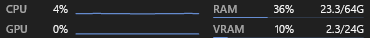
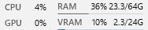
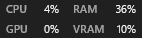

# Preferred layout and visibility verification

Verified locally on October 21, 2026, on Windows 11 build 26300.9711 using
Windhawk 1.7.3's compiler and engine libraries. This record describes the local
implementation on `feature/widget-layout-preferences` before the 1.9.0 version
bump; the installed mod was not changed. See the [1.9.0 release notes](releases/1.9.0.md)
for the final release qualification.

Related requests:
- [Hide disabled temperatures, #19](https://github.com/starychenko/windhawk-taskbar-system-info/issues/19)
- [Individual graph switches, #6435](https://github.com/ramensoftware/windhawk-mods/issues/6435)

## Behavior

- Preferred layout selects Full, Without graphs, Compact two rows, or Compact
  one row. Full remains the default. Insufficient space selects a layout with
  the same or fewer details; more space restores the preference. Compact one
  row can use two rows when horizontal space is limited.
- Show CPU graph and Show GPU graph independently control history in Full
  layout. Both default to enabled. CPU/GPU percentages and history collection
  remain active. Automatic adaptation never restores a manually hidden graph.
- Temperature source Disabled removes both temperature cells, their columns
  and their width. Missing data from an enabled provider still displays `--°C`.
- Main widget, secondary widgets and native move previews share the layout
  policy. Placement/reservation caches include all new content preferences.
  Changing content also re-evaluates a previously rejected dock reservation.

## Observed dimensions

Actual XAML host widths, in logical pixels, with the default font, width 410,
network hidden and the repository's illustrative documentation samples:

| Configuration | Width |
| --- | ---: |
| Full | 410 |
| Full, temperatures disabled | 370 |
| Both graphs disabled | 219 |
| Temperatures and both graphs disabled | 188 |
| Compact two rows, temperatures disabled | 142 |
| Compact one row, temperatures disabled | 286 |

Disabling only one graph leaves the shared two-row column wide enough for the
other graph, so that configuration remains 410 pixels. Widths depend on font,
capacity budgets, network visibility and available space. They are not thresholds.
The dock test also verifies that compact content reduces the actual reserved
margin, not just the widget's internal drawing.

These are isolated renders of the production widget. Values come from the
existing documentation fixture; they are not live workstation measurements.
Dark/light variants, individual graphs, compact rows and visible text bounds
were inspected using the generated images in `build-ui-smoke`.

## Checks performed

- `python -B tests/validate-source.py`: passed, 35 settings, English/Ukrainian
  options and existing source contracts.
- `./tests/run-regression.ps1`: passed, 180,255 behavioral checks. New cases
  cover real width savings, graph swaps at unchanged outer dimensions, preferred
  layouts, fallback/restoration, hidden fields, network combinations, pointer
  anchoring and destination previews at four DPI scales.
- `./tests/run-ui-smoke.ps1`: complete suite passed. New coverage includes 256
  selected-layout scenarios with real XAML, three native preview DPI scales,
  confirmation checks, and 96 secondary-widget preference/resize/restore cases
  on another UI thread. The suite also passed the existing 105 font/height/width
  cases, five preview DPI scales, 200,000 generated real-font geometries, copy
  lifecycle/coordinator checks, Styler/dock tests and stale-history recovery.
- `./build.ps1`: x64 build passed without compiler warnings.
- `./build.ps1 -Architecture aarch64 -OutputDirectory build-arm64`: ARM64
  cross-build passed without compiler warnings.
- `git diff --check`: passed. Changed text files were re-read and checked as
  UTF-8 without BOM with CRLF line endings and unchanged decoded text.
- Metrics smoke was not rerun: this change does not modify metric collectors.
  Provider regressions remain covered by the regression suite above.

Pre-release implementation SHA-256 (local UTF-8/CRLF file, before the version bump):
`003B9DCCF58E2A37D8993D16E31B161BC7CA127A2D34850A6C7FE1EC1C04E5B7`.

## Remaining limits

Live Explorer validation is incomplete. The available Windows UI tool did not
expose the taskbar as a targetable window, so the candidate was not installed.
The original installed library, enabled state and settings timestamp were
rechecked and remained unchanged. Real secondary displays, physical hot-plug,
mixed-DPI transfers, ARM64 hardware and other Styler configurations are untested.
The isolated secondary-thread and DPI checks do not establish those live flows.
